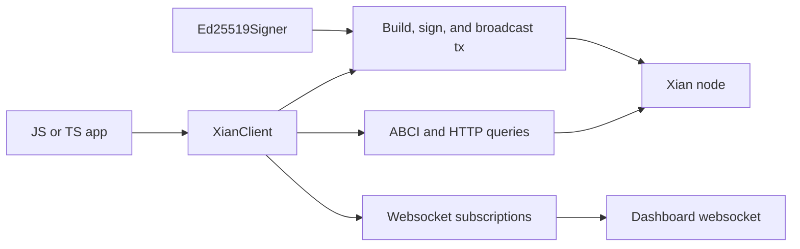

# @xian-tech/client

This package owns the typed Xian client surface for JS / TS consumers.

It includes:

- HTTP and ABCI query helpers
- transaction payload building, signing, and broadcast helpers
- versioned, chain/account-bound external message signing helpers
- raw Ed25519 primitives for transaction internals and explicit low-level use
- websocket subscriptions for dashboard state and event streams

It does not own:

- browser wallet discovery
- wallet-provider event contracts
- framework-specific bindings

`XianClient.sendTx(...)` reserves automatic nonces per client instance, chain,
and sender, including across concurrent calls. It serializes each same-scope
build/sign/broadcast lifecycle so sequential nonces reach CheckTx in order;
different senders and chains remain concurrent. Explicit nonces bypass the
manager. Structured rejection makes the next send refresh the network nonce;
an ambiguous transport or wait timeout blocks further automatic sends until
the network nonce advances or the caller deliberately invokes
`resetNonceReservation(...)` after independent reconciliation.

Use `signXianMessage(...)` and `verifyXianMessage(...)` for external messages.
Their version-1 payload is length-prefixed and binds the signature to a Xian
chain ID and account. `signMessage(...)` and `verifyMessage(...)` operate on raw
UTF-8 bytes and must not be used to implement a wallet's `xian_signMessage`
request.

Indexed transaction `payload` and event `data` / `dataIndexed` fields are
normalized to records whether BDS returns objects or JSON text. Large integers
remain `bigint`; malformed or non-object columns become `null`. The original
row remains available as `raw`. Event consumers should read both `dataIndexed`
(indexed identifiers) and `data` (other fields). An absent recent-events index
returns `available: false`; an available index with no events returns an empty
list with `available: true`.

The client, compiler bridge, standalone wire codecs and transaction preparation default to `xian_vm_v2`. For an archived V1 test configuration, explicitly set `vmProfile: "xian_vm_v1"` or pass `"xian_vm_v1"` to the standalone helpers.
Pass decimals as `fixed("1.25")` and integers above the safe-integer range
as `bigint`. For user-entered nested JSON use `parseContractJson(text)`. It
reads numeric tokens before JavaScript rounds them. Contract calls and state
reads return decimals as exact strings and large integers as `bigint`.

Use `compileContractArtifacts({ moduleName, source })` from `@xian-tech/client` with the optional WASM compiler installed to inspect a V2 artifact offline. Pass `vmProfile: "xian_vm_v1"` to reproduce archived V1 artifacts. Deployments send cleartext source to the validator.
